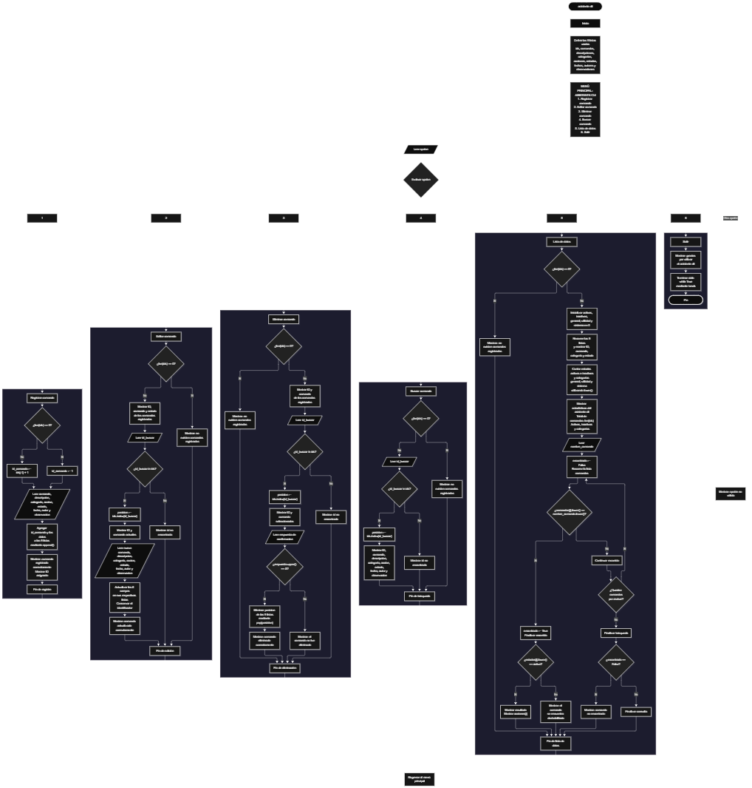

Este proyecto, llamado <b>asistente cli</b>, fue desarrollado en <b>python</b> como un ejercicio práctico para fortalecer la lógica de programación mediante la creación de un sistema de gestión de comandos desde la consola. El programa cuenta con un menú principal de seis opciones que permite <b>registrar, editar, eliminar, buscar y listar comandos, además de consultar estadísticas y mostrar las acciones asociadas a los comandos activos</b>. Cada comando almacena información como su identificador, nombre, descripción, categoría, acción, estado, fecha de creación, autor y observación. Para organizar los registros, se utilizan nueve listas paralelas que mantienen relacionados los datos de cada comando durante la ejecución. Durante su desarrollo se aplicaron conceptos fundamentales de programación, como variables, listas, estructuras condicionales, ciclos repetitivos, búsqueda de registros, contadores y manejo de cadenas de texto. Este proyecto permite poner en práctica los conocimientos adquiridos en python y sirve como base para desarrollar asistentes de consola y sistemas de administración de comandos más avanzados.

<h2 align="center">⚙️ Funcionamiento del menú principal</h2>

### ➕ Registrar comando

La opción <b>1) registrar comando</b> permite incorporar un nuevo comando al sistema. Antes de almacenar los datos, el programa comprueba si la lista <b>ids</b> está vacía mediante la condición <b>len(ids) == 0</b>. Si no existen registros, asigna el identificador inicial <b>1</b> a la variable <b>id_comando</b>. En caso contrario, genera el siguiente identificador sumando uno al último ID almacenado mediante la expresión <b>ids[-1] + 1</b>. A continuación, solicita el nombre del comando, la descripción, la categoría, la acción que ejecutará, el estado, la fecha de creación, el autor y la observación. Los datos se almacenan en sus respectivas listas mediante el método <b>append()</b>, conservando la correspondencia entre las posiciones de los registros. Finalmente, muestra el mensaje <b>"comando registrado correctamente."</b> y presenta el identificador asignado. El código no establece una capacidad máxima de comandos ni valida que los campos introducidos estén completos.

### ✏️ Editar comando

La opción <b>2) editar comando</b> permite modificar la información de un comando registrado. Primero, el programa comprueba si existen registros mediante la condición <b>len(ids) == 0</b>. Si la lista está vacía, muestra el mensaje <b>"no existen comandos registrados."</b>. En caso contrario, presenta una lista con el identificador, el nombre y el estado de cada comando mediante un ciclo <b>for</b>. Después, solicita el identificador que se desea editar y convierte la entrada a un número entero utilizando <b>int()</b>. El programa comprueba si el ID existe en la lista <b>ids</b> y, si lo encuentra, obtiene su posición mediante <b>ids.index(id_buscar)</b>. A continuación, muestra el identificador y el nombre actuales, y solicita los nuevos valores del nombre, la descripción, la categoría, la acción, el estado, la fecha, el autor y la observación. Los nuevos datos sustituyen directamente los valores anteriores en sus respectivas listas, mientras que el identificador permanece sin cambios. Finalmente, muestra el mensaje <b>"comando actualizado correctamente."</b>. Si el ID no existe, presenta el mensaje <b>"id no encontrada."</b>.

### 🗑️ Eliminar comando

La opción <b>3) eliminar comando</b> permite eliminar un comando registrado mediante su identificador. Primero, el programa comprueba si existen comandos almacenados. Si no hay registros, muestra el mensaje <b>"no existen comandos registrados."</b>. Si existen datos, presenta una lista con el ID y el nombre de cada comando. Después, solicita el identificador que se desea eliminar y lo convierte a un número entero mediante <b>int()</b>. Si el ID existe en la lista <b>ids</b>, obtiene su posición con <b>ids.index(id_buscar)</b> y muestra el identificador y el nombre del comando seleccionado. A continuación, solicita confirmación mediante la pregunta <b>"¿desea eliminar este comando? (s/n): "</b>. La eliminación se realiza únicamente cuando la respuesta, convertida a mayúsculas mediante <b>upper()</b>, coincide con <b>"S"</b>. Si se confirma la operación, el programa utiliza <b>pop(posicion)</b> para eliminar la posición correspondiente en las nueve listas: <b>ids, comandos, descripciones, categorias, acciones, estados, fechas, autores y observaciones</b>. Finalmente, muestra el mensaje <b>"comando eliminado correctamente."</b>. Si la respuesta no es S, muestra <b>"el comando no fue eliminado."</b>. Si el ID no existe, presenta <b>"id no encontrada."</b>.

### 🔎 Buscar comando

La opción <b>4) buscar comando</b> permite localizar un comando mediante su identificador y consultar toda su información. Antes de iniciar la búsqueda, el programa comprueba si existen registros. Si la lista <b>ids</b> está vacía, muestra el mensaje <b>"no existen comandos registrados."</b>. En caso contrario, solicita el ID que se desea buscar y convierte la entrada a un número entero utilizando <b>int()</b>. Después, comprueba si el identificador se encuentra en la lista <b>ids</b>. Si existe, obtiene su posición mediante <b>ids.index(id_buscar)</b> y muestra el identificador, el nombre, la descripción, la categoría, la acción, el estado, la fecha, el autor y la observación. De esta manera, el usuario puede consultar los datos completos de un comando sin necesidad de recorrer manualmente todos los registros. Si el ID introducido no está almacenado, el programa presenta el mensaje <b>"id no encontrada."</b>.

### 📋 Lista de datos

La opción <b>5) lista de datos</b> permite visualizar los comandos registrados, consultar estadísticas y mostrar la acción asociada a un comando específico. Primero, el programa comprueba si existen registros. Si no hay comandos almacenados, muestra el mensaje <b>"no existen comandos registrados."</b>. Si existen datos, inicializa cinco contadores: <b>activos, inactivos, general, utilidad y sistema</b>, todos con el valor inicial cero. Después, utiliza un ciclo <b>for</b> para recorrer las listas y mostrar el identificador, el nombre, la categoría y el estado de cada comando. Durante el recorrido, compara los estados mediante <b>estados[i].lower()</b> para contar los comandos activos e inactivos. También compara las categorías mediante <b>categorias[i].lower()</b> para contabilizar los comandos pertenecientes a las categorías general, utilidad y sistema. Al finalizar, muestra el total de comandos registrados mediante <b>len(ids)</b> y presenta las estadísticas calculadas. Posteriormente, solicita el nombre del comando que se desea consultar o ejecutar. La búsqueda compara los nombres mediante <b>comandos[i].lower() == nombre_comando.lower()</b>, permitiendo encontrar coincidencias sin distinguir entre mayúsculas y minúsculas. Cuando encuentra el comando, comprueba su estado. Si está activo, muestra el apartado de resultado y el contenido almacenado en <b>acciones[i]</b>. Si está inactivo, informa que el comando se encuentra deshabilitado. Si no encuentra coincidencias, muestra el mensaje <b>"comando no encontrado."</b>. La búsqueda finaliza al encontrar la primera coincidencia. Es importante señalar que el programa muestra el texto de la acción almacenada, pero no ejecuta realmente instrucciones de Python ni comandos del sistema.

### 🚪 Salir del menú principal

La opción <b>6) salir</b> permite finalizar la ejecución del programa. Cuando el usuario selecciona esta opción, el sistema muestra el mensaje <b>"gracias por utilizar el asistente cli."</b> y ejecuta la instrucción <b>break</b>, que interrumpe el ciclo <b>while True</b> del menú principal. De esta manera, el usuario puede finalizar el programa después de realizar las operaciones de administración de comandos que necesite. Si introduce un valor que no corresponde a ninguna de las seis opciones, el programa muestra el mensaje <b>"opción no válida."</b> y vuelve a presentar el menú principal.

<h2 align="center">🧠 Temas aplicados en el proyecto</h2>

### 📦 Variables

En este proyecto se utilizan variables para controlar las opciones del menú, generar identificadores, localizar comandos, almacenar temporalmente las entradas del usuario y calcular estadísticas. También se emplean variables de control para determinar si se encontró un comando y para contar los registros que pertenecen a determinados estados y categorías. Cada variable cumple una función específica dentro de las operaciones de gestión y consulta.

🔢 **Opcion:** Almacena la opción seleccionada por el usuario en el menú principal.

🆔 **Id_comando:** Contiene el identificador generado durante el registro de un comando.

🔎 **Id_buscar:** Almacena el identificador introducido para editar, eliminar o buscar un comando.

📍 **Posicion:** Indica el índice del comando encontrado en las listas paralelas.

📝 **Comando:** Almacena el nombre del comando introducido durante el registro.

📊 **Activos e inactivos:** Son contadores utilizados para calcular la cantidad de comandos según su estado.

📂 **General, utilidad y sistema:** Son contadores que registran las cantidades de comandos correspondientes a las categorías reconocidas.

🔍 **Nombre_comando:** Almacena el nombre introducido por el usuario para localizar un comando en la opción de lista de datos.

✅ **Encontrado:** Variable lógica que comienza en `False` y cambia a `True` cuando se encuentra una coincidencia por nombre.

### 🗃️ Listas

En este proyecto se utilizan nueve listas paralelas para almacenar la información de los comandos. Todas se inicializan vacías y aumentan o disminuyen su cantidad de elementos según las operaciones de registro y eliminación. Cada lista utiliza el mismo índice para representar los datos correspondientes a un mismo comando. Por ejemplo, la información del comando ubicado en la posición <b>0</b> se distribuye entre <b>ids[0], comandos[0], descripciones[0], categorias[0], acciones[0], estados[0], fechas[0], autores[0] y observaciones[0]</b>. Esta organización permite consultar, modificar y eliminar los registros manteniendo relacionados todos sus campos.

🆔 **Ids:** Almacena los identificadores de los comandos.

📝 **Comandos:** Almacena los nombres de los comandos registrados.

📄 **Descripciones:** Guarda las descripciones de cada comando.

📂 **Categorias:** Almacena las categorías asignadas a los comandos.

⚙️ **Acciones:** Guarda el texto que se muestra como resultado cuando un comando está activo.

🔘 **Estados:** Almacena el estado de cada comando, por ejemplo, activo o inactivo.

📅 **Fechas:** Guarda las fechas de creación de los comandos.

👤 **Autores:** Almacena los nombres de los autores de los comandos.

📌 **Observaciones:** Guarda información adicional asociada a cada registro.

### 🔀 Estructuras condicionales

En este proyecto se utilizan las estructuras <b>if, elif y else</b> para controlar las operaciones del menú principal y determinar qué instrucciones deben ejecutarse en cada situación. Estas condiciones permiten comprobar si existen comandos registrados, verificar si un identificador está presente en la lista, decidir si se confirma una eliminación, distinguir los estados activos e inactivos, clasificar los comandos por categoría y comprobar si el nombre solicitado fue encontrado. También se utiliza una condición final para informar cuando la opción introducida no corresponde a ninguna de las alternativas disponibles.

### 🔄 Estructuras repetitivas

El programa utiliza los ciclos <b>while</b> y <b>for</b> para mantener el menú en funcionamiento y recorrer los comandos almacenados. El ciclo <b>while True</b> mantiene activo el menú principal hasta que el usuario selecciona la opción de salida y se ejecuta <b>break</b>. Por su parte, los ciclos <b>for</b> permiten mostrar los registros disponibles, calcular estadísticas, contar comandos por estado y categoría y buscar coincidencias por nombre. Estos ciclos facilitan la administración de varios comandos sin necesidad de escribir instrucciones individuales para cada registro.

### 🎯 Selección del menú

El programa utiliza una estructura condicional <b>if, elif y else</b> para evaluar el valor almacenado en la variable <b>opcion</b>. Cada alternativa corresponde a una operación del sistema: registrar, editar, eliminar, buscar, listar datos o salir. Cuando el usuario selecciona una opción válida, se ejecuta el bloque de instrucciones correspondiente. Si introduce un valor diferente de las opciones definidas, el programa muestra el mensaje <b>"opción no válida."</b> y continúa con el menú principal.

### 🔍 Búsqueda de registros

La búsqueda por identificador se realiza mediante el operador <b>in</b>, que comprueba si el ID introducido existe en la lista <b>ids</b>. Cuando encuentra una coincidencia, el método <b>index()</b> devuelve la posición del identificador y permite acceder a los datos correspondientes en las demás listas. En la opción de lista de datos, la búsqueda se realiza mediante un recorrido de la lista <b>comandos</b> y una comparación de cadenas con <b>lower()</b>. Esta última permite localizar un comando sin distinguir entre letras mayúsculas y minúsculas.

### 📊 Contadores y estadísticas

El programa utiliza contadores numéricos para resumir la información almacenada. Las variables <b>activos</b> e <b>inactivos</b> contabilizan los comandos según su estado, mientras que <b>general, utilidad y sistema</b> registran las cantidades de comandos de las categorías reconocidas. Los contadores comienzan en cero y aumentan en uno cuando una condición coincide con los datos del registro actual. Al finalizar el recorrido, el programa muestra las cantidades obtenidas junto con el total de comandos almacenados. Los valores que no coinciden con los estados o categorías reconocidos no se incluyen en estos contadores.

### 🔤 Manejo de cadenas de texto

El proyecto utiliza los métodos <b>lower()</b> y <b>upper()</b> para adaptar las comparaciones de texto a determinadas necesidades. El método <b>lower()</b> convierte temporalmente los textos a minúsculas, lo que permite comparar nombres, estados y categorías sin distinguir entre mayúsculas y minúsculas. Por su parte, <b>upper()</b> convierte la respuesta de confirmación a mayúsculas para aceptar la letra <b>S</b> tanto si el usuario la introduce en mayúscula como en minúscula. Estos métodos facilitan las comparaciones sin modificar necesariamente el texto original almacenado.

### 🛠️ Métodos y operaciones con listas

Para administrar los registros, el programa utiliza varios métodos y operaciones integrados de Python. El método <b>append()</b> incorpora nuevos elementos al final de las listas, mientras que <b>pop(posicion)</b> elimina el elemento situado en el índice indicado. El método <b>index()</b> permite obtener la posición de un identificador encontrado, y la expresión <b>len(ids)</b> devuelve la cantidad de comandos registrados. También se utiliza el índice negativo <b>ids[-1]</b> para acceder al último identificador almacenado y generar el siguiente ID durante el registro. Estas operaciones permiten gestionar los datos sin utilizar una base de datos externa.

<h2 align="center">¿Cómo se implementaron las operaciones crud en el proyecto?</h2>

Las operaciones <b>crud</b> se implementaron mediante las opciones del menú principal para administrar los comandos registrados. La operación <b>crear</b> corresponde a <b>registrar comando</b>, donde se solicita la información de un nuevo registro y se almacena en las nueve listas. La operación <b>leer</b> se realiza mediante <b>buscar comando</b> y <b>lista de datos</b>, que permiten consultar los datos, visualizar los registros y revisar las estadísticas. La operación <b>actualizar</b> corresponde a <b>editar comando</b>, donde se modifican los campos de un comando existente sin cambiar su identificador. Finalmente, la operación <b>eliminar</b> se implementa mediante <b>eliminar comando</b>, que solicita confirmación y elimina los datos de la posición correspondiente en todas las listas. Estas operaciones utilizan estructuras condicionales, ciclos y métodos de listas para mantener organizada la información durante la ejecución del programa.

<h2 align="center">Diagrama de flujo del proyecto</h2>

<h2 align="center">🛡️ Validaciones del programa</h2>

### 📭 No existen comandos registrados

Esta comprobación se utiliza en las opciones de <b>editar, eliminar, buscar y lista de datos</b>. El programa verifica si la lista <b>ids</b> está vacía mediante la condición <b>len(ids) == 0</b>. Si no existen comandos almacenados, muestra el mensaje <b>"no existen comandos registrados."</b> y evita continuar con las operaciones que requieren registros previos. Esta comprobación permite informar al usuario de que primero necesita registrar comandos para utilizar estas funcionalidades.

### 🔎 Identificador no encontrado

Esta comprobación se utiliza durante las operaciones de <b>editar, eliminar y buscar comando</b>. Después de solicitar el identificador, el programa comprueba si el valor introducido se encuentra en la lista <b>ids</b> mediante el operador <b>in</b>. Si existe, obtiene su posición y permite continuar con la operación solicitada. Si el identificador no está registrado, muestra el mensaje <b>"id no encontrada."</b>. Esta comprobación evita intentar acceder a una posición correspondiente a un ID inexistente.

### ⚠️ Confirmación de eliminación

Antes de eliminar un comando, el programa solicita confirmación mediante una entrada de texto. La condición <b>respuesta.upper() == "S"</b> determina si debe realizarse la eliminación. Cuando el usuario confirma con la letra S, el programa elimina el registro de las nueve listas mediante <b>pop(posicion)</b>. Si introduce cualquier otra respuesta, el sistema cancela la operación y muestra el mensaje <b>"el comando no fue eliminado."</b>. Esta comprobación permite evitar eliminaciones accidentales cuando el usuario no confirma la acción.

### 🔘 Comando activo o inactivo

Esta comprobación se utiliza en la opción <b>lista de datos</b>, cuando el usuario introduce el nombre del comando que desea ejecutar. Después de encontrar una coincidencia, el programa comprueba si el estado almacenado en <b>estados[i]</b>, convertido a minúsculas, coincide con <b>"activo"</b>. Si se cumple la condición, muestra el contenido de <b>acciones[i]</b>. En caso contrario, presenta el mensaje <b>"el comando se encuentra deshabilitado."</b>. Esta comprobación controla qué acciones almacenadas se muestran al usuario, aunque no ejecuta realmente el contenido de dichas acciones.

### 📊 Clasificación por estados y categorías

Durante la generación de estadísticas, el programa compara los estados de los comandos con los valores <b>"activo"</b> e <b>"inactivo"</b>, y las categorías con <b>"general"</b>, <b>"utilidad"</b> y <b>"sistema"</b>. Las comparaciones utilizan el método <b>lower()</b>, por lo que no distinguen entre mayúsculas y minúsculas. Cuando un registro coincide con uno de estos valores, el contador correspondiente aumenta en uno. Sin embargo, el código no valida que el usuario introduzca exclusivamente estos estados o categorías durante el registro o la edición; los valores diferentes de los reconocidos simplemente no se incluyen en las estadísticas correspondientes.

### ⚠️ Entradas numéricas y datos incompletos

En las opciones de edición, eliminación y búsqueda, el programa convierte el identificador introducido mediante <b>int()</b>. Sin embargo, no comprueba previamente si la entrada contiene un número entero válido. Si el usuario introduce letras u otro contenido no convertible a entero, Python puede generar un error y detener la ejecución. De igual manera, el programa no verifica que los campos obligatorios estén completos ni restringe los estados y las categorías a una lista de valores permitidos. Estas limitaciones forman parte del funcionamiento actual del código y pueden abordarse en futuras mejoras.

### 🆔 Generación de identificadores

Durante el registro, el programa utiliza la condición <b>len(ids) == 0</b> para determinar si debe asignar el identificador inicial <b>1</b>. Si ya existen registros, obtiene el último ID de la lista mediante <b>ids[-1]</b> y le suma uno. Este procedimiento genera identificadores consecutivos mientras los registros se mantengan en el orden esperado. No obstante, si se elimina el último comando y se registra uno nuevo, el identificador eliminado puede reutilizarse, debido a que el programa no conserva un contador independiente de identificadores.

### ⚠️ Almacenamiento temporal

Los comandos se almacenan exclusivamente en las listas que se crean al inicio del programa. No se utiliza una base de datos, archivos externos ni otro mecanismo de persistencia. Por esta razón, los registros permanecen disponibles mientras el programa está en ejecución, pero se pierden cuando finaliza. Esta característica permite practicar la administración de datos mediante listas y constituye una base para incorporar posteriormente mecanismos de almacenamiento permanente.

### ⚠️ Opción inválida

La estructura condicional del menú incluye un bloque <b>else</b> que muestra el mensaje <b>"opción no válida."</b> cuando el valor introducido no coincide con ninguna de las seis opciones disponibles. Después de mostrar el mensaje, el ciclo <b>while True</b> continúa y vuelve a presentar el menú principal. Esta comprobación permite mantener el programa en funcionamiento cuando se introduce una opción que no está definida.

<h2 align="center">🎯 Objetivo del proyecto</h2>

El objetivo principal de este proyecto es fortalecer la <b>lógica de programación</b> mediante el desarrollo de un sistema de gestión de comandos en <b>python</b>. A través de su construcción se busca aplicar los conocimientos adquiridos sobre variables, listas, estructuras condicionales, ciclos repetitivos, búsquedas, manejo de cadenas y operaciones con registros. Además, el proyecto permite comprender cómo organizar información relacionada mediante listas paralelas, implementar operaciones de creación, consulta, actualización y eliminación, y generar estadísticas a partir de los datos almacenados. El sistema también introduce el concepto de comandos asociados a acciones y el control de su disponibilidad mediante estados, proporcionando una base para desarrollar asistentes de consola más completos y ampliar sus funcionalidades en futuros proyectos.

